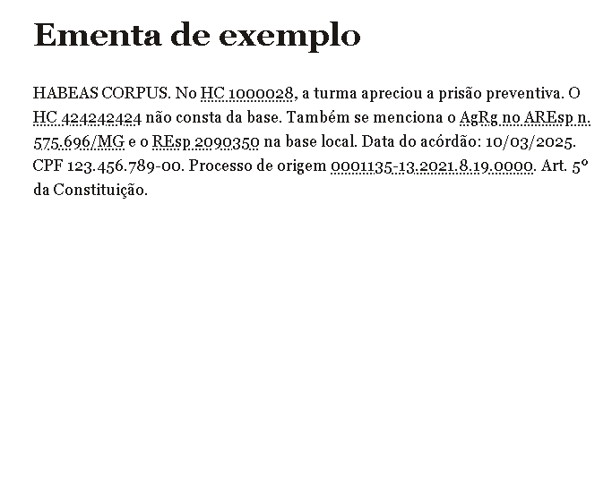

# Jurimetria no tribunal

Extensão de Chrome que reconhece número de processo nas páginas do STJ e do STF. Ao passar o mouse, ou ao focar o número pelo teclado, abre uma ficha com resultado, relator, data e os links da decisão.

A consulta manda só tribunal, classe e número. O texto da página não sai do navegador. Número CNJ é só sublinhado: esta versão não consulta a API.



## O que precisa

- [Node.js](https://nodejs.org/) 22 ou mais novo
- Google Chrome

## Instalar em modo desenvolvedor

Na pasta `extensao`:

```bash
npm install
npm run build
```

No Chrome:

1. Abra `chrome://extensions`.
2. Ative o **Modo do desenvolvedor**.
3. Clique em **Carregar sem compactação** e escolha a pasta `extensao` (a que contém o `manifest.json`).

Sempre que mudar o código, rode `npm run build` de novo e clique em atualizar na extensão.

## Ver a ficha

Em outro terminal, ainda na pasta `extensao`:

```bash
npm run serve
```

Deixe esse comando aberto. Ele sobe a API de exemplo e a página com uma ementa.

Abra http://127.0.0.1:8787

Os números de processo ficam sublinhados. Passe o mouse em **HC 1000028** para ver as decisões. **HC 424242424** mostra que não há decisão na base. Data, CPF e artigo de lei não são sublinhados.

O endereço padrão da API é `http://127.0.0.1:8787`. Para apontar para outro, abra os detalhes da extensão e clique em **Opções da extensão**. O campo BASE é o começo do endereço, sem a rota.

## Testes

```bash
npm test
```

O workflow `.github/workflows/extensao.yml` roda esses testes e o build só quando a pasta `extensao/` muda.

## PDF

O visualizador de PDF do Chrome não entrega o texto do arquivo para outras extensões. A ficha não aparece dentro de um PDF aberto nesse visualizador. Ela funciona nas páginas HTML de `processo.stj.jus.br`, `scon.stj.jus.br` e `portal.stf.jus.br`.

## Publicar

A publicação na Chrome Web Store fica com o time do Jurimetria. Esta entrega para no modo desenvolvedor.
